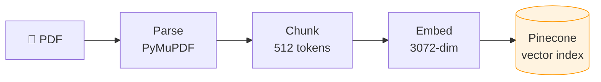
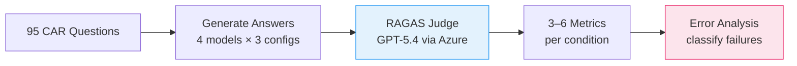
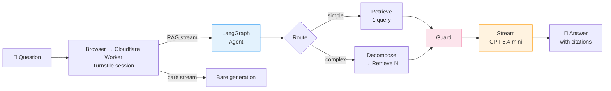
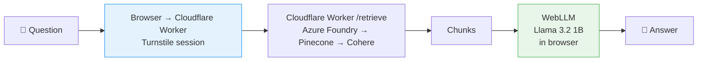

# AeroQuery

AeroQuery is a research project focused on answering aviation questions grounded in Canadian aviation regulations (TC CARs), combining dense retrieval, reranking, and evaluation.

The project is served as a live demo at https://aeroquery.anant-j.com.

## Why this project exists

I am a Canadian Private Pilot Licence holder and a Software Engineer. While training for my licence, I realized that aviation regulations are hierarchical, repetitive, and difficult to navigate without context.

At the same time, I wanted to explore how RAG systems work in production environments. I also noticed that the smaller open-source on-device models I had access to were not really trained on Canadian aviation regulations (TC CARs), but instead on American aviation regulations (FAA FAR).

This project is a learning and research prototype. It is not a validated aviation decision-support system and should not be relied on as operational guidance.

## What the system does

AeroQuery is a retrieval-augmented QA system for TC CAR. It ingests regulatory PDFs, chunks and embeds the content, retrieves relevant passages, reranks them, and generates answers grounded in source sections.

The project explores several core AI engineering questions:

- How well does retrieval improve factual grounding over a bare LLM?
- Does reranking materially improve context quality?
- Can answer quality be evaluated in a repeatable way using LLM-based judges?
- How do we serve these systems in a live application with citations and streaming responses?

## Architecture

### Ingestion pipeline


### Evaluation pipeline


### Query flow


### WebLLM browser flow


## Solution stack

| Layer | Tool |
|---|---|
| PDF parsing | PyMuPDF |
| Embeddings | Azure OpenAI text-embedding-3-large deployment (3072 dims) |
| Vector DB | Pinecone (serverless, cosine, namespaces) |
| Reranking | Cohere rerank-v4.0-pro |
| Agentic workflow | LangGraph |
| Hosted LLM | Azure OpenAI / AI Foundry GPT-5.4-mini for agent routing and answer generation |
| Local LLM | WebLLM Llama 3.2 1B in the browser |
| Evaluation | RAGAS; Azure GPT-5.4 judge and embeddings, plus Azure/Ollama generation models |
| Streaming | SSE for server-side generation, WebLLM SDK in-browser |
| API | Cloudflare Python Workers |
| Frontend | Next.js, React, TypeScript, and Tailwind CSS |
| Deployment | Cloudflare Workers + Netlify |

## Project structure

```text
api/          — live retrieval API and agent endpoints
pipeline/    — offline ingestion, embedding, indexing, and eval
web/         — Next.js frontend and streaming generation UI
```

The repository is intentionally split into an offline data pipeline and a live serving layer:

- `pipeline/` builds the knowledge base, parses source documents, embeds them, and benchmarks model choices.
- `api/` and `web/` serve the system to users through retrieval and generation endpoints.

## Key capabilities

- PDF ingestion and normalization of technical regulatory text
- Chunking and vector indexing for retrieval over large document corpora
- Dense retrieval + reranking for higher-quality context selection
- Grounded answer generation with citation-aware responses
- Query routing and decomposition using LangGraph
- Browser-side inference with WebLLM
- End-to-end benchmark evaluation using RAGAS-style metrics
- Streaming responses and expandable source citations in the frontend

## Evaluation benchmark

The project includes an exploratory evaluation benchmark over Canadian aviation regulations, with multiple model and retrieval configurations.

### Benchmark framing

These are provisional results from 95 shared questions of a 250-question machine-generated benchmark, without a documented held-out split or independent human scoring process. GPT-5.4 judged the responses, including its own. Factual correctness was rescored with question-aware claim evaluation; scores from the earlier protocol are not directly comparable.

### Representative results

**Factual correctness**

| Model | Bare LLM | RAG | RAG + Rerank | RAG minus bare (95% CI) |
|---|---:|---:|---:|---:|
| GPT-5.4-nano | 0.378 | 0.532 | 0.533 | +0.153 (+0.0739 to +0.2306) |
| GPT-5.4-mini | 0.464 | 0.604 | 0.597 | +0.140 (+0.0655 to +0.2132) |
| GPT-5.4 | 0.447 | 0.489 | 0.497 | +0.042 (-0.0213 to +0.1076) |
| Llama 3.2 1B | 0.126 | 0.293 | 0.305 | +0.166 (+0.1142 to +0.2180) |

Paired intervals describe uncertainty in the change on the same questions. The GPT-5.4 interval includes zero, so its factual-correctness improvement is uncertain.

**Retrieval quality**

| Metric | RAG | RAG + Rerank |
|---|---:|---:|
| Context Precision | 0.913 | 0.955 |
| Context Recall | 0.989 | 1.000 |

**Reranking**

Reranking improved context precision, but the paired factual-correctness intervals for reranking include zero for all four models. The [full results](pipeline/eval/results/car/all_summaries.json) include the other metrics and comparisons.

### Evaluation limitations and next steps

- The benchmark is machine-generated and has not been independently human-scored; review it and evaluate the full set, stratified by chapter, question type, and difficulty.
- The evaluator records failed metrics as missing values and reports valid sample counts, bootstrap intervals, and paired comparisons.
- LLM-based scores and faithfulness to retrieved context do not establish that an answer is legally correct or safe for aviation decisions.
- Version the dataset, prompts, retrieval index, and model configurations for future benchmark runs.

## Environment and deployment

Use server-managed settings for live credentials and keep them out of browser bundles. The Cloudflare Worker calls Azure AI Foundry for live embeddings and generation; direct OpenAI credentials are only used by the offline evaluation pipeline.

```bash
# Create web/.env.local from the variables documented in web/README.md.
# Configure api/.dev.vars for local Worker secrets; see api/README.md.
```

Required runtime values include:

- `NEXT_PUBLIC_CLOUDFLARE_WORKER_API_URL`, `NEXT_PUBLIC_CLOUDFLARE_WORKER_KEY`, and `NEXT_PUBLIC_TURNSTILE_SITE_KEY` for direct browser calls. The application key is public; rotate the previous private gateway key.
- Worker `ALLOWED_ORIGINS`, Turnstile and JWT signing secrets, and Azure Foundry, Pinecone, and Cohere credentials; see `api/README.md`.

Never expose secret values in `NEXT_PUBLIC_*` variables and never commit real credentials.

## Privacy and safety

The Cloudflare Worker records question timestamps and mode in D1. The checked-in configuration also stores question text in D1, but not in Worker application logs. A Cron Trigger purges entries older than 30 days. Set `QUESTIONS_LOG_QUERY_TEXT` to `false` to omit question text from D1, and adjust retention to match your privacy policy.

## Notes

This project is intentionally framed as a research prototype and learning exercise. It is not a validated aviation decision-support system and should not be treated as operational guidance for flight, compliance, or regulatory interpretation.

## License

This repository is intended for research and portfolio use. Please review the relevant project and service licenses before reuse or commercial deployment.
