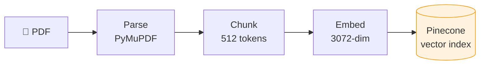
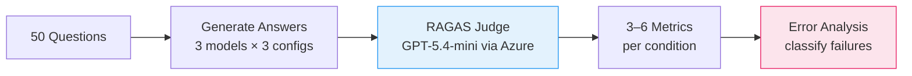
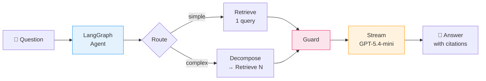
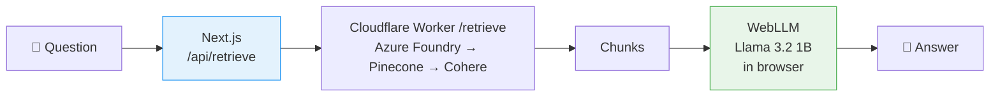

# AeroQuery

AeroQuery is a research project focused on answering aviation questions grounded in Canadian aviation regulations (TC AIM), combining dense retrieval, reranking, and evaluation.

The project is served as a live demo at https://aeroquery.anant-j.com.

## Why this project exists

I am a Canadian Private Pilot Licence holder and a Software Engineer. While training for my licence, I realized that aviation regulations are hierarchical, repetitive, and difficult to navigate without context.

At the same time, I wanted to explore how RAG systems work in production environments. I also noticed that the smaller open-source on-device models I had access to were not really trained on Canadian aviation regulations (TC AIM), but instead on American aviation regulations (FAA FAR).

This project is a learning and research prototype. It is not a validated aviation decision-support system and should not be relied on as operational guidance.

## What the system does

AeroQuery is a retrieval-augmented QA system for TC AIM. It ingests regulatory PDFs, chunks and embeds the content, retrieves relevant passages, reranks them, and generates answers grounded in source sections.

The project explores several core AI engineering questions:

- How well does retrieval improve factual grounding over a bare LLM?
- Does reranking materially improve context quality?
- Can answer quality be evaluated in a repeatable way using LLM-based judges?
- How do we serve these systems in a live application with citations and streaming responses?

## Architecture

### Ingestion pipeline


### Evaluation pipeline


### Query flow


### WebLLM browser flow


## Solution stack

| Layer | Tool |
|---|---|
| PDF parsing | PyMuPDF |
| Embeddings | Azure OpenAI text-embedding-3-large deployment (3072 dims) |
| Vector DB | Pinecone (serverless, cosine, namespaces) |
| Reranking | Cohere rerank-v4.0-pro |
| Agentic workflow | LangGraph |
| Hosted LLM | Azure OpenAI / AI Foundry GPT-5.4-mini for agent routing and answer generation |
| Local LLM | WebLLM Llama 3.2 1B in the browser |
| Evaluation | RAGAS; Azure GPT-5.4-mini judge, direct OpenAI embeddings, plus Azure/OpenAI/Ollama generation models |
| Streaming | SSE for server-side generation, WebLLM SDK in-browser |
| Orchestration | LangChain + LangGraph for the agent; LiteLLM for the evaluation judge |
| API | Cloudflare Python Workers |
| Frontend | Next.js, React, TypeScript, and Tailwind CSS |
| Deployment | Cloudflare Workers + Netlify |

## Project structure

```text
api/          — live retrieval API and agent endpoints
pipeline/    — offline ingestion, embedding, indexing, and eval
web/         — Next.js frontend and streaming generation UI
```

The repository is intentionally split into an offline data pipeline and a live serving layer:

- `pipeline/` builds the knowledge base, parses source documents, embeds them, and benchmarks model choices.
- `api/` and `web/` serve the system to users through retrieval and generation endpoints.

## Key capabilities

- PDF ingestion and normalization of technical regulatory text
- Chunking and vector indexing for retrieval over large document corpora
- Dense retrieval + reranking for higher-quality context selection
- Grounded answer generation with citation-aware responses
- Query routing and decomposition using LangGraph
- Browser-side inference with WebLLM
- End-to-end benchmark evaluation using RAGAS-style metrics
- Streaming responses and expandable source citations in the frontend

## Evaluation benchmark

The project includes an exploratory evaluation benchmark over a set of aviation questions, with multiple model and retrieval configurations.

### Benchmark framing

These are historical point estimates from a single run and should not be interpreted as a final or generalizable performance claim. The benchmark currently includes 50 questions across 40 TC AIM sections, without a documented held-out split or independent human scoring process. The evaluator also uses an LLM judge and the historical results reflect earlier scoring behavior.

### Representative results

**Factual correctness**

| Model | Bare LLM | RAG | RAG + Rerank | Improvement |
|---|---:|---:|---:|---:|
| GPT-5.4-mini | 0.32 | 0.40 | 0.43 | +34% |
| GPT-3.5-turbo | 0.23 | 0.44 | 0.44 | +91% |
| Llama 3.2 1B | 0.07 | 0.18 | 0.22 | +203% |

**Retrieval quality**

| Metric | RAG | RAG + Rerank |
|---|---:|---:|
| Context Precision | 0.78 | 0.92 |
| Context Recall | 0.92 | 0.92 |

**Generation quality**

| Metric | GPT-5.4-mini | GPT-3.5 | Llama 1B |
|---|---:|---:|---:|
| Faithfulness | 0.88 | 0.85 | 0.55 |
| Answer Relevancy | 0.79 | 0.87 | 0.62 |
| Semantic Similarity | 0.77 | 0.79 | 0.69 |

### Evaluation limitations and next steps

- The 50-question set is exploratory and has not been independently human-scored; expand it and stratify by chapter, question type, and difficulty.
- The evaluator records failed metrics as missing values and reports valid sample counts, bootstrap intervals, and paired comparisons.
- The checked-in result rows predate the current evaluator protocol and do not include those uncertainty and paired-comparison summaries. Re-run the evaluator before treating those newer statistics as published results.
- Version the dataset, prompts, retrieval index, and model configurations for future benchmark runs.

## Environment and deployment

Use server-managed settings for live credentials and keep them out of browser bundles. The Cloudflare Worker calls Azure AI Foundry for live embeddings and generation; direct OpenAI credentials are only used by the offline evaluation pipeline.

```bash
# Create web/.env.local from the variables documented in web/README.md.
# Configure api/.dev.vars for local Worker secrets; see api/README.md.
```

Required runtime values include:

- `CLOUDFLARE_WORKER_API_URL` and `CLOUDFLARE_WORKER_KEY` for server-side Next.js calls to the protected Worker
- Azure Foundry, Pinecone, and Cohere credentials as Cloudflare Worker secrets; see `api/README.md`

Never expose secret values in `NEXT_PUBLIC_*` variables and never commit real credentials.

## Privacy and safety

The Cloudflare Worker records question timestamps, mode, and query length in D1. Query text logging is disabled by default; when enabled, a Cron Trigger purges entries older than 30 days. Adjust the retention setting to match your privacy policy.

## Notes

This project is intentionally framed as a research prototype and learning exercise. It is not a validated aviation decision-support system and should not be treated as operational guidance for flight, compliance, or regulatory interpretation.

## License

This repository is intended for research and portfolio use. Please review the relevant project and service licenses before reuse or commercial deployment.
