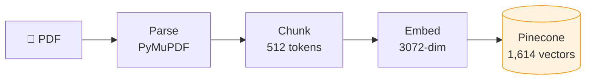
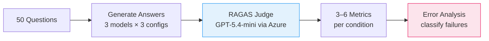
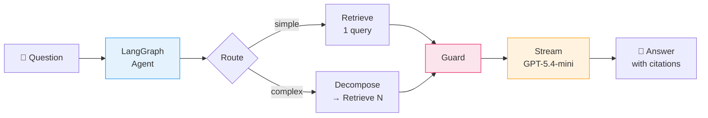
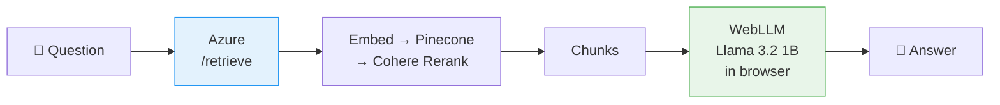

# AeroQuery

Research prototype for question answering over Canadian aviation regulations (TC AIM), with dense retrieval, Cohere reranking, an evaluation pipeline, and a live demo.

## Why This Project

I'm a Canadian pilot building my PPL. Aviation regulations are dense, hierarchical, and full of cross-references — a useful setting for studying retrieval and grounded generation. This is a learning project, not a validated aviation decision-support tool.

## Architecture

### Ingestion Pipeline


### Eval Pipeline


### Query Flow — OpenAI + LangGraph


### Query Flow — WebLLM (in-browser)


## Project Structure

```
pipeline/      — Offline: PDF ingestion, chunking, embedding, eval (runs locally in Docker)
api/           — Live: Azure Function serving retrieval (embed → Pinecone → rerank)
web/           — Live: Next.js frontend + streaming generation (calls API + OpenAI)
```

`pipeline/` *builds* the system (parses docs, fills Pinecone, benchmarks with RAGAS). `api/` + `web/` *serve* it. Once Pinecone is populated, the pipeline only runs again for re-ingestion or eval.

See each folder's README for setup and run instructions.

## Tech Stack

| Layer | Tool |
|---|---|
| PDF Parsing | PyMuPDF |
| Embeddings | OpenAI text-embedding-3-large (3072 dims) |
| Vector DB | Pinecone (serverless, cosine, namespaces) |
| Reranking | Cohere rerank-v4.0-pro |
| Agentic Layer | LangGraph (query routing, decomposition, guard) |
| LLM | OpenAI GPT-5.4-mini (server), WebLLM Llama 3.2 1B (browser) |
| Eval | RAGAS v0.4 (6 metrics), Azure AI Foundry (judge) |
| Streaming | SSE via Next.js API route (OpenAI), WebLLM SDK (browser) |
| Orchestration | LangChain + LangGraph (agent), LiteLLM (multi-provider routing) |
| API | Azure Functions (retrieval), Next.js API route (generation) |
| Frontend | Next.js + Tailwind CSS |
| Deployment | Azure (API + AI Foundry) + Netlify (frontend) |

## Eval Benchmark (RAGAS v0.4 — 6 Metrics)

**Exploratory results — 50-question benchmark**

These are historical point estimates from one run, not reliable evidence of general performance. The benchmark currently has 50 questions across 40 TC AIM sections; it has no documented sampling protocol, independent human scoring, or held-out split. Scores were judged by a single GPT-5.4-mini judge, and the original evaluation script converted judge errors to zero. The evaluator now preserves failed scores as missing and reports bootstrap intervals, but the checked-in historical scores have not yet been rerun with that correction.

**Factual Correctness** (does the answer match ground truth?):

| Model | Bare LLM | RAG | RAG + Rerank | Improvement |
|---|---|---|---|---|
| GPT-5.4-mini | 0.32 | 0.40 | **0.43** | +34% |
| GPT-3.5-turbo | 0.23 | **0.44** | 0.44 | +91% |
| Llama 3.2 1B | 0.07 | 0.18 | **0.22** | +203% |

**Retrieval Quality** (retrieved contexts are shared; judge-scored metrics may vary by run):

| Metric | RAG | RAG + Rerank |
|---|---|---|
| Context Precision | 0.78 | **0.92** |
| Context Recall | **0.92** | 0.92 |

**Generation Quality:**

| Metric | GPT-5.4-mini | GPT-3.5 | Llama 1B |
|---|---|---|---|
| Faithfulness (RAG+Rerank) | **0.88** | 0.85 | 0.55 |
| Answer Relevancy (RAG+Rerank) | 0.79 | **0.87** | 0.62 |
| Semantic Similarity (RAG+Rerank) | 0.77 | **0.79** | 0.69 |

*Observed means only; no significance or generalization claims are made. The bare-LLM condition has three applicable metrics, while each RAG condition has six: the complete run therefore has 2,250 score slots (not 2,700), before any judge failures.*

**Evaluation limitations and next steps**

- Expand toward a 500-question benchmark using source-cited, human-reviewed examples; do not treat generated questions or answers as ground truth without review.
- Stratify by TC AIM chapter, question type, and difficulty; document source edition, evidence location, inclusion criteria, and reviewer decisions.
- Keep a held-out test set and publish per-question results alongside means, paired comparisons, and confidence intervals.
- Interpret bootstrap intervals as uncertainty across sampled questions only; they do not capture judge bias, judge randomness, or benchmark selection bias.
- Calibrate the LLM judge against human ratings and report judge failures rather than silently treating them as zero.
- Re-run and publish results after the dataset, retrieval index, models, and prompts are versioned.

## Current Status

- [x] PDF ingestion pipeline (parse, clean, chunk, embed, upsert)
- [x] RAG query pipeline (retrieve, rerank, generate with citations)
- [x] Eval pipeline (LLM-as-judge, multi-model comparison, bootstrap intervals)
- [x] Cohere Reranking
- [x] Azure Functions API (`/agent` + `/retrieve` endpoints)
- [x] Next.js frontend (side-by-side RAG vs bare LLM comparison + eval table)
- [x] Deployed — [Live Demo](https://aeroquery.netlify.app) | [API](https://aeroquery-api.azurewebsites.net/api)
- [x] WebLLM client-side model (Llama 3.2 1B, runs in browser via WebGPU)
- [x] Streaming responses (SSE for OpenAI, SDK streaming for WebLLM)
- [x] Expandable source citations (click §section to see retrieved chunk text)
- [x] LangGraph agentic layer (query classification, decomposition, guard)
