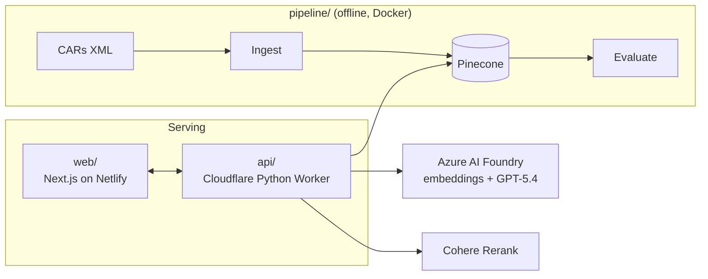
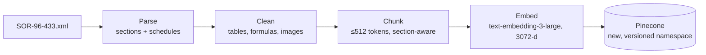
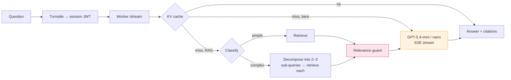
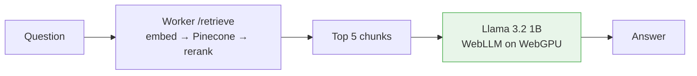
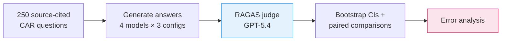

# AeroQuery

**Retrieval-augmented question answering over the Canadian Aviation Regulations (TC CARs, SOR/96-433), with a reproducible evaluation benchmark.**

Live demo: **https://aeroquery.anant-j.com**

> Research prototype. Not a validated aviation decision-support tool — do not use it for flight, compliance, or regulatory decisions.

## Why this project exists

I'm a Canadian Private Pilot Licence holder and a software engineer. While training for my licence, I found the CARs hard to navigate: they're hierarchical, full of cross-references, and their exceptions are often buried in other sections.

I also noticed that small open models, the kind you can run on-device, mostly learned the **American FAA FARs**, not the Canadian CARs. Ask one about Canadian fuel reserves or currency requirements and you often get a confident answer about US rules.

AeroQuery started as a way to answer two questions:

1. How much does retrieval actually improve factual answers on a narrow regulatory domain, across models of different sizes?
2. What does it take to run a RAG system as a real public app, with streaming, citations, abuse protection, caching, and privacy-aware logging?

## Highlights

- **End-to-end RAG system:** structured XML ingestion, dense retrieval, reranking, query decomposition, and grounded answers with citations, streamed over SSE.
- **Three ways to answer:** hosted GPT-5.4-mini or GPT-5.4-nano, or **Llama 3.2 1B running entirely in the browser** via WebLLM/WebGPU, each with or without RAG.
- **Measured, not assumed:** a 4-model × 3-configuration benchmark scored with RAGAS. It reports paired bootstrap confidence intervals, so it's clear when a gain is just noise.
- **Built for public traffic:** Cloudflare Turnstile sessions, per-IP and per-session rate limits, an origin allowlist, a nonce-based CSP, a KV answer cache, and D1 logs that expire automatically.

## Architecture

The repo is split into an **offline pipeline** that builds the knowledge base and runs evaluations, and a **serving layer**: a Cloudflare Worker and a Next.js frontend.

### Ingestion

The source is the official CARs XML from the Justice Laws website. Using the XML instead of a PDF keeps section numbers, headings, and tables intact.

- Each chunk carries its section number, title, and official source URL, so answers can cite specific sections.
- Each chunk is prefixed with its place in the regulations (part, subpart, section), so even a fragment of a long section keeps its context when embedded.
- Images and complex formulas are replaced with explicit placeholders telling the reader to consult the source, rather than being dropped silently.
- Every ingestion writes to a **new, empty namespace** (e.g. `canada-car-2026-06-17`), and the vector count is checked after upload. Re-indexing can never corrupt the live index, and evaluation results stay tied to one corpus version.

The current index holds **2,045 chunks**.

### Query flow (hosted models)

- **Retrieve:** embed the query with Azure, fetch the top 10 chunks from Pinecone, and rerank them with Cohere `rerank-v4.0-pro` down to the top 5.
- **Decompose:** comparison and multi-part questions (e.g. *"day vs. night VFR fuel requirements"*) are split into sub-queries. Each is retrieved separately and the results are deduplicated.
- **Guard:** if nothing relevant comes back (no chunks, or a top rerank score below 0.1), the model is told the context is insufficient, so it doesn't improvise an answer.
- **Generate:** the system prompt treats retrieved text as untrusted data, not instructions. It requires answers to come only from the sources, forbids invented citations, and asks the model to flag conflicting sources.

### In-browser flow (WebLLM)

Retrieval runs on the Worker, but generation runs entirely on the user's GPU. This answers a practical question: can a 1B model that fits in a browser tab be useful once it has the right context?

### Evaluation

- **Matrix:** GPT-5.4, GPT-5.4-mini, GPT-5.4-nano (Azure) and Llama 3.2 1B (Ollama), each run bare, with RAG, and with RAG + rerank.
- **Reproducible:** a manifest records the hashes of the questions and prompts, the namespace, the reranker, and the judge model. Runs resume where they left off, and the evaluator refuses to mix results produced under different settings.
- **Statistically honest:** failed judgments are recorded as missing rather than zero. Improvements are reported with paired bootstrap confidence intervals on the same questions.

## Results (provisional)

Results cover 95 questions from a 250-question benchmark. The questions were machine-generated and haven't been reviewed by a human yet. GPT-5.4 judged every answer, including its own.

**Factual correctness**

| Model | Bare | RAG | RAG + Rerank | RAG − bare (95% CI) |
|---|---:|---:|---:|---:|
| GPT-5.4-nano | 0.378 | 0.532 | 0.533 | +0.153 (+0.074 to +0.231) |
| GPT-5.4-mini | 0.464 | 0.604 | 0.597 | +0.140 (+0.066 to +0.213) |
| GPT-5.4 | 0.447 | 0.489 | 0.497 | +0.042 (−0.021 to +0.108) |
| Llama 3.2 1B | 0.126 | 0.293 | 0.305 | +0.166 (+0.114 to +0.218) |

**Retrieval quality**

| Metric | RAG | RAG + Rerank |
|---|---:|---:|
| Context precision | 0.913 | 0.955 |
| Context recall | 0.989 | 1.000 |

**Takeaways**

- **RAG helps the smaller models the most.** With retrieval, GPT-5.4-nano beats bare GPT-5.4, and Llama 3.2 1B more than doubles its score.
- **The largest model gains the least.** GPT-5.4's confidence interval includes zero, so its improvement is uncertain.
- **Reranking improves the context but not the answers.** Precision goes up, but no model's factual correctness changes significantly. With strong first-stage recall, the reranker has little to fix.

Full metrics: [`pipeline/eval/results/car/all_summaries.json`](pipeline/eval/results/car/all_summaries.json).

**Limitations:**
- An LLM judge and source faithfulness don't establish that an answer is legally correct.
- Next steps: human-review the benchmark, then evaluate all 250 questions, broken down by section and question type.

## Tech stack

| Layer | Technology |
|---|---|
| Source data | CARs XML (SOR/96-433) from the Justice Laws website |
| Embeddings | Azure OpenAI `text-embedding-3-large` (3072-d) |
| Vector DB | Pinecone serverless, cosine similarity, versioned namespaces |
| Reranking | Cohere `rerank-v4.0-pro` |
| Generation | Azure AI Foundry GPT-5.4-mini / nano; WebLLM Llama 3.2 1B in the browser |
| API | Cloudflare Python Workers, KV (answer cache), D1 (question logs), rate limiting |
| Frontend | Next.js, React, TypeScript, Tailwind CSS on Netlify |
| Abuse protection | Cloudflare Turnstile, session JWTs, nonce-based CSP |
| Evaluation | RAGAS, GPT-5.4 judge, Ollama for local models |

## Repository

| Folder | What it is |
|---|---|
| [`api/`](api/README.md) | Cloudflare Worker: auth, retrieval, agent, streaming generation |
| [`web/`](web/README.md) | Next.js frontend, including in-browser WebLLM |
| [`pipeline/`](pipeline/README.md) | Offline ingestion into Pinecone and the evaluation benchmark |

Each folder's README covers local setup.

## Privacy

The Worker logs questions (timestamp, mode, model, sources, and by default the question text) to Cloudflare D1. A daily cron deletes rows older than 60 days. Set `QUESTIONS_LOG_QUERY_TEXT=false` to stop storing question text. No secrets are shipped to the browser: the only browser-side values are a public app key and the Turnstile site key.

## License

See [LICENSE](LICENSE).
